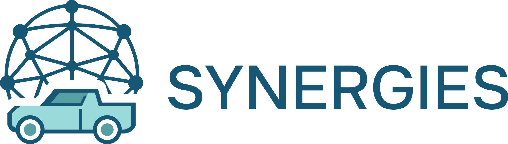

# TRACE — Traffic scenario Recognition and Context Extraction

TRACE is a desktop tool (PyQt6) that builds driving-interaction scenarios from a
lane map plus trajectories, extracts semantic interaction rules with a
JSON-configurable **GoRules** engine, indexes scenarios into a searchable
**event-sequence database**, finds similar historical scenarios, produces a
human-readable explanation that mirrors the search key, and exports the result
as **OpenSCENARIO 1.0** (`.xosc`) for replay in esmini.

## Features

- **Two input modes**
  - *Manual*: click waypoints for V1/V2 on the lane mask; duration + FPS resampling.
  - *JSON (OpenLABEL)*: pick frame range + two vehicle IDs from tracked objects.
- **Scenario context construction**: per-vehicle Frenet `s`/`d` (continuous
  `s_global` across lane changes), pairwise distance / Δs / Δd / TTC timeline,
  route semantics (`FOLLOW / LANE_CHANGE / DIVERGE / TRANSFER`), topology facts
  (shared merges/diverges, junctions).
- **Event detection**: `waiting`, `lane_change` (topology-validated lateral
  moves), `proximity` (distance-gated episodes).
- **Rule extraction**: GoRules expression + decision nodes defined in
  `scenario_gorules.json` (cut-in, merge, yield, near-miss variants, avoidance,
  overtake, tailgating, car following, waiting-for-gap, complex/connector
  navigation, …), plus an optional temporal sequence matcher
  (`sequence_rules`).
- **Scenario signature + deterministic 128-d embedding**:
  `S{same_lane}_M{merges}_D{diverges}_J{junction} || routeA | routeB || ONE:waiting -> AB:proximity ...`
- **Human explanation** (`Explain Rules`): the same semantic sequence the
  similarity search matches on, plus global metrics, compact event counts,
  rule timeline (with `only fired` filter) and insights.
- **Semantic DB + similarity search**: build an event-sequence database from
  OpenLABEL data (per-vehicle + all vehicle pairs, ≥ 50 common frames, spatial
  prefilter); score candidates with
  `0.60 × event + 0.40 × topology` where event = `0.50·LCS + 0.20·Jaccard +
  0.30·subsequence`; click a result to preview the candidate on the map.
- **OpenSCENARIO export**: two vehicles with `DefaultDriver` controllers,
  lane-seed or world-position spawn, speed hold, time-triggered lane changes,
  stop at scenario end, parameter declarations from insights.
- **Optional LSTM-VAE latent signatures** (single-vehicle model; see below).

## Architecture

```
 mask / layout / homography / xODR / OpenLABEL
                 │
        LaneMapViewer  (lane_map_viewer_gui.py, LaneCanvas)
                 │  map_scenario_context {actors A/B, interaction_facts,
                 │                       interaction_topology, meta}
                 ▼
        ScenarioRuleGUI  (scenario_rule_gui.py)
                 │  suggest_rules_combined()
                 ▼
   scenario_engine.py ──── scenario_gorules.json (thresholds + rule DSL)
   signal_engine.py      (validation, normalization, kinematics, pairwise)
   road_infrastructure.py (Frenet, region lookup, lane relations)
                 │
   ├─ rule table + insights table
   ├─ explanation_generator.py  (search-key-mirroring text)
   ├─ semantic DB (build / load / find-similar / preview)
   ├─ OpenScenarioExporter.py   (.xosc → esmini)
   └─ lstm_single_bridge.py     (optional latent signatures)
```

| Module | Responsibility |
|---|---|
| `main_app.py` | Window + signal wiring between the two panes |
| `lane_map_viewer_gui.py` | Canvas, waypoint/JSON trajectories, context building, semantic DB, similarity search |
| `scenario_rule_gui.py` | Rule generation, explanation, insights, JSON/xOSC export |
| `scenario_engine.py` | Event detectors, GoRules engine, temporal matcher, descriptor, embedding, searchable sequences |
| `signal_engine.py` | Context schema (jsonschema), normalization, kinematics, pairwise computer, `SignalConfig` |
| `road_infrastructure.py` | Regions, centerlines, homography, Frenet projection, topology context |
| `explanation_generator.py` | Human-readable scenario explanation |
| `OpenScenarioExporter.py` | OpenSCENARIO 1.0 writer |
| `lstm_single_bridge.py` | LSTM-VAE single/pair feature contracts, path assignment, latent signatures |
| `scenario_gorules.json` | Config thresholds + decision nodes (external rule logic) |

## Requirements

- Python **≥ 3.10**
- Core: `numpy`, `scipy`, `opencv-python`, `PyQt6`, `matplotlib`, `jsonschema`
- Optional: `torch` (LSTM-VAE bridge), **esmini** (external, for `.xosc` replay)

## Installation

```bash
python -m venv .venv
source .venv/bin/activate        # Windows: .venv\Scripts\activate
pip install -e .                 # or: pip install -r requirements.txt
pip install -e ".[lstm]"         # optional: LSTM-VAE bridge
```

> **Run from the project root** — `scenario_gorules.json` is loaded relative to
> the working directory.

## Running

```bash
python main_app.py    # or: trace
```

Left pane = map viewer, right pane = scenario rule editor.

## Input files

| File | Format | Notes |
|---|---|---|
| Mask | `.png` / `.tif` / `.npy` | Integer region IDs, `0` = non-drivable |
| Layout | JSON | Flat `{region_id: {...}}` or `{"regions": {...}}`. Consumed fields: `type` (`lane`, `connecting_lane`, `overlap`), `polygon`, `centerline`, `successors`, `predecessors`, `adjacent`, `adjacent_geometric`, `merges_with`, `shares_upcoming_junction_with`, `junction_id`, `is_connecting_road`, `roadId`/`laneId`, `members` (overlap) |
| Homography | JSON | `{"transformation_matrix": 3×3 (px→world), "inverse_matrix": 3×3}` |
| OpenDRIVE | `.xODR` | Referenced by the exported `.xosc` |
| OpenLABEL | JSON | `{"openlabel": {"frames": {"<f>": {"objects": {"<oid>": {"object_data": {"rbbox": [{"name": "shape", "val": [cx, cy, w, h, ang, ...]}]}}}}}}}` |
| Project | `.trace` | JSON of the five input paths (New / Open / Save) |
| Paths library | JSON | For the LSTM bridge (`assign_path_id`), e.g. `cleaned/paths_library.json` |

## Workflow A — Manual waypoints

1. **New** (or the individual Mask / Layout / H / xODR buttons) to load the map components.
2. Mode **Manual**: press **✏️** next to V1, click ≥ 2 waypoints on the map (drag to
   adjust); repeat for V2.
3. Set **Dur** (s) and **FPS**; press **Generate** (resamples both trajectories
   uniformly in arc length).
4. Press **Apply** — builds and validates the scenario context.
5. Right pane: **Generate Rule Suggestions** — populates the rule table (WHO /
   WHAT / WHEN / WHERE / DETAILS) and the insights table.
6. **Explain Rules** (optional "Explain only fired rules") — shows the scenario
   signature, ordered semantic event sequence, metrics, rule timeline and insights.
7. **Save Scenario JSON**, **Export Insights**, **Export OpenSCENARIO (.xosc)**.
8. Optional: **Load Paths JSON** + **Load SINGLE Model (.pth)** for latent signatures.

## Workflow B — OpenLABEL (JSON)

1. Load map components **and** the OpenLABEL file.
2. Mode **JSON**: choose start/end frame; the V1/V2 dropdowns list vehicles
   present in the whole range.
3. **Apply** — draws both trajectories and emits the context.
4. Same steps 5–8 as above.
5. **Build/Refresh DB Index** — writes an event-sequence database
   (per-vehicle tracks + all vehicle pairs with ≥ 50 common frames and a spatial
   proximity prefilter).
6. **Load Semantic DB** + **Find Similar** — ranked candidates in the list;
   clicking one previews its two trajectories on the map (yellow/magenta).
   Without a generated base scenario, the button instead lists the top-50
   candidate windows from the precomputed index
   (`0.5·same_lane + 0.3·1/min_TTC + 0.2·1/min_dist`).

## Scenario signature & similarity search

The signature (shown in the explanation and stored in the descriptor) is:

```
S0.85_M1_D1_J3 || FOLLOW→DIVERGE | FOLLOW→LANE_CHANGE || ONE:waiting -> AB:proximity
```

- `S…` fraction of frames on the same lane, `M/D` shared merge/diverge points,
  `J` shared-junction frames.
- Route chains are the per-actor transition token sequences.
- Event chain: `AB:` if ≥ 2 participants else `ONE:`, time-ordered.
- Bigram transitions and motifs feed both the deterministic embedding
  (128-d, hash-bucketed tokens) and the DB indices
  (`_event_index`, `_transition_index`).

Similarity scoring with a base scenario:
`score = 0.60·(0.50·LCS + 0.20·Jaccard + 0.30·subsequence) + 0.40·route_topology`,
candidates with `score < 0.15` are dropped, top 50 are listed.

## OpenSCENARIO export

The exporter produces a conformant OpenSCENARIO 1.0 file: `FileHeader`,
`ParameterDeclarations` (from numeric insights), `RoadNetwork` (relative
`LogicFile` path when possible), `Entities` (two cars with bounding boxes and
`DefaultDriver` controllers), and a `Storyboard` with:

- teleport to the first route waypoint's road/lane (`LanePosition`) or,
  fallback, the trajectory start (`WorldPosition` with heading);
- step speed action to the mean trajectory speed;
- one `LaneChangeAction` per timeline-derived lane change (same road only);
- a stop 0.5 s before the scenario end.

Event times from the engine are rescaled to the real scenario duration
automatically. Replay with esmini:

```bash
esmini --scenario scenario.xosc --output
```

## Optional: LSTM-VAE signatures

`lstm_single_bridge.py` implements the exact training contract:

- **Single**: per 10 Hz step `[d, d_dot, psi, psi_dot]` (normalized globally,
  clipped) + path embedding; windowed encoding (default window 40, stride 5);
  signature = mean `z_mu`, `z_std`, reconstruction error and robust
  d/psi statistics.
- **Pair (Option B1)**: 12-dim symmetric block with a shared path embedding.

Load via **Load Paths JSON** / **Load SINGLE Model (.pth)** in the scenario
panel. The module imports without PyTorch (`available() == False`).

## Configuration

- `scenario_gorules.json` → `config`: all thresholds (`proximity_dist`,
  `critical_distance_m`, `near_miss_ttc_s`, `shared_lane_following_fraction`,
  `waiting_speed_threshold_mps`, `min_wait_duration_s`, …).
  → `decision.rule_scope`: pair- vs vehicle-scoped subtypes.
  → `decision.nodes`: expression + decision nodes (edit to change rule logic —
  no code changes needed).
  → `sequence_rules` (optional): temporal graph rules for the matcher.
- `signal_engine.SignalConfig`: `same_lane_dd=1.2 m`, `aligned_ds=1.0`,
  `lateral_threshold=0.5`, `interest_dist_m=8.0`, `interest_ttc_frames=3`.


## Development

```bash
pip install -e ".[dev]"
ruff check .          # lint
pytest                # tests live in tests/ (add your suite here)
```

Debug contexts are dumped to `debug_contexts/` when enabled.

## Troubleshooting

| Symptom | Fix |
|---|---|
| "Context not ready for rule evaluation" | Press **Apply** in the viewer first |
| No rules generated | Ensure `scenario_gorules.json` is in the CWD; check the log for GoRules warnings |
| xOSC has an empty RoadNetwork | Load the `.xODR` before exporting |
| "World conversion failed" | Check homography + mask coverage of the trajectory |
| Similarity preview fails | Candidate vehicles must exist in the currently loaded OpenLABEL file |
| "Too few trajectory points" | Pick a frame range where both vehicles are tracked |


## License

TRACE is licensed under the [GNU Affero General Public License v3.0 (AGPL-3.0)](LICENSE).

## Acknowledgement
<br><div align="center">
  
</div>

This package is developed as part of the [SYNERGIES](https://synergies-ccam.eu/) project.

<br><div align="center">
  
</div>

Funded by the European Union. Views and opinions expressed are however those of the author(s) only and do not necessarily reflect those of the European Union or European Climate, Infrastructure and Environment Executive Agency (CINEA). Neither the European Union nor the granting authority can be held responsible for them.